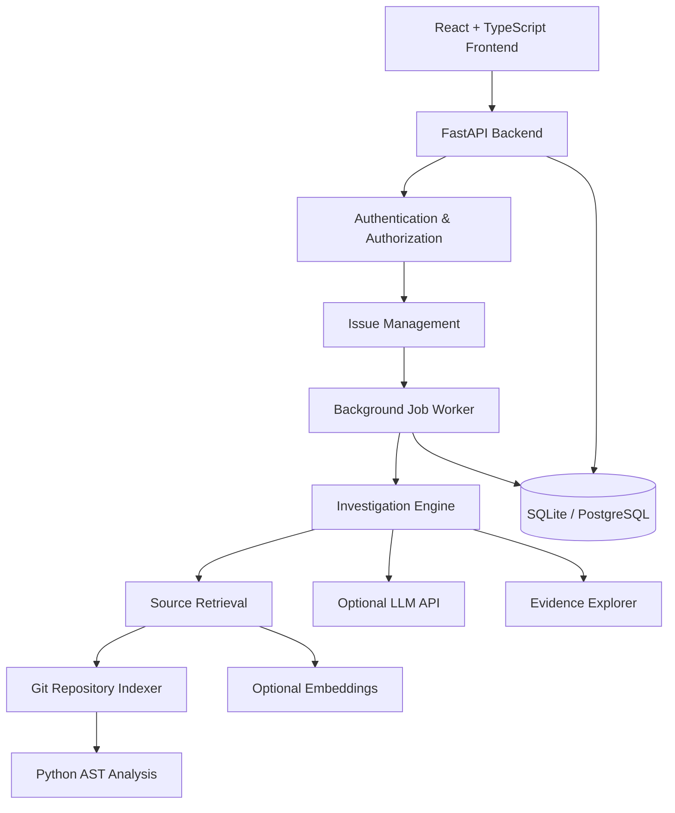
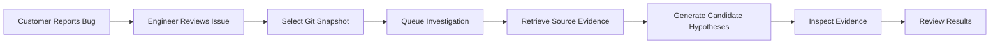

 <div align="center">

# 🐞 BugHound-AI

### Autonomous Agentic AI for Software Issue Diagnosis

**An intelligent, evidence-driven platform for investigating software issues, analyzing Python repositories, and accelerating debugging workflows.**


**[Overview](#-overview) • [Features](#-key-features) • [Architecture](#-system-architecture) • [Installation](#-getting-started) • [Roadmap](#-development-roadmap)**

</div>

---

## 📖 Overview

**BugHound-AI** is a full-stack, AI-assisted software issue investigation platform designed to streamline the debugging process for engineering teams.

It allows customers to submit structured bug reports while engineers investigate reported issues against immutable Git repository snapshots.

By combining **source-code indexing, intelligent retrieval, optional LLM reasoning, background job processing, and traceable source evidence**, BugHound-AI provides a foundation for advanced agentic debugging workflows.

### The Problem

Traditional debugging often involves:

- Manually navigating large codebases.
- Searching multiple files to locate faulty logic.
- Understanding unfamiliar code structures.
- Investigating incomplete bug reports.
- Tracking investigation results across disconnected tools.

### Our Solution

BugHound-AI provides a centralized investigation workspace that helps engineers discover relevant source code, inspect candidate hypotheses, and validate evidence with exact file locations.

> **Current implementation:** A working local development demo with lexical retrieval and configurable AI integration. Full autonomous root-cause diagnosis remains a future capability.

---

## ✨ Key Features

| Feature | Description |
|---|---|
| 🐛 Issue Management | Structured customer bug reporting and issue tracking |
| 🔍 Source Code Intelligence | Git indexing and Python AST-based source analysis |
| 🤖 AI-Assisted Investigation | Optional LLM-generated investigation hypotheses |
| 🧠 Hybrid Retrieval | Lexical search with optional semantic embeddings |
| 📌 Evidence Explorer | Exact source paths, line ranges, symbols, and SHA-256 hashes |
| ⚡ Background Processing | Durable asynchronous investigation and indexing jobs |
| 🔐 Role-Based Access | Customer, engineer, and administrator workspaces |
| 📊 Activity Monitoring | Job status and audit event visibility |
| 🗄️ Database Persistence | SQLite locally and PostgreSQL/pgvector development support |
| 🐳 Containerization | Docker Compose development stack |

---

## 🛠️ Technology Stack

### Frontend


### Backend & AI


### Database & DevOps


---

## 🏗️ System Architecture



### Architecture Highlights

- **Frontend:** React-based customer, engineer, and administrator interfaces.
- **API Layer:** FastAPI REST endpoints with authorization and validation.
- **Repository Layer:** Immutable Git commit indexing and AST analysis.
- **Retrieval Layer:** Lexical ranking and optional semantic retrieval.
- **AI Layer:** Constrained prompts and validated investigation outputs.
- **Processing Layer:** Persistent background jobs and failure handling.
- **Storage Layer:** Relational persistence with optional vector capabilities.

---

## 🔄 Investigation Workflow



In retrieval-only mode, candidate results are based on source retrieval rather than LLM reasoning.

---

## 🚀 Getting Started

### Prerequisites

| Requirement | Version |
|---|---|
| Python | 3.13 |
| Node.js | 22+ |
| Git | Installed |
| PowerShell | Windows |
| Docker Desktop | Optional |

### 1. Open the Repository

Open PowerShell in the BugHound-AI project root.

### 2. Install and Initialize

```powershell
./scripts/setup.ps1
```

This initializes the environment, seeds three buggy Python examples, and queues repository indexing.

### 3. Start the Application

```powershell
./scripts/start.ps1
```

### 4. Access the Application

| Service | URL |
|---|---|
| Web Application | http://127.0.0.1:8000 |
| API Documentation | http://127.0.0.1:8000/docs |

Choose **Enter as Customer**, **Enter as Engineer**, or **Administrator Workspace**.

Demo authentication is strictly for local development.

---

## 💻 Development Mode

Run each service in a separate terminal.

**Terminal 1 — FastAPI**

```powershell
$env:PYTHONPATH='apps/api'
.venv/Scripts/python -m uvicorn app.main:app --host 127.0.0.1 --port 8000 --reload
```

**Terminal 2 — Background Worker**

```powershell
$env:PYTHONPATH='apps/api'
.venv/Scripts/python -m app.worker
```

**Terminal 3 — React Frontend**

```powershell
cd apps/web
npm install
npm run dev
```

The frontend development server uses Vite, which proxies `/api` requests to the backend.

---

## 📁 Project Structure

```text
BugHound-AI/
├── apps/
│   ├── api/
│   │   ├── app/
│   │   │   ├── main.py
│   │   │   ├── db.py
│   │   │   ├── indexer.py
│   │   │   ├── retrieval.py
│   │   │   ├── investigator.py
│   │   │   ├── worker.py
│   │   │   ├── admin.py
│   │   │   └── seed.py
│   │   └── migrations/
│   └── web/
│       └── src/
├── scripts/
│   ├── setup.ps1
│   ├── start.ps1
│   └── evaluate.py
├── docs/
│   └── DELIVERY.md
├── data/
├── output/
├── .env.example
├── docker-compose.yml
└── README.md
```

---

## 🤖 AI Model Configuration

Copy the environment template:

```powershell
Copy-Item .env.example .env
```

Configure a compatible model endpoint:

```dotenv
MODEL_MODE=live
MODEL_BASE_URL=YOUR_MODEL_ENDPOINT
MODEL_API_KEY=YOUR_API_KEY
MODEL_NAME=YOUR_MODEL_NAME
```

Optional embedding configuration:

```dotenv
EMBEDDING_MODEL=YOUR_EMBEDDING_MODEL
```

The embedding endpoint must return 1536-dimensional vectors. Reindex a fresh repository snapshot after changing the embedding model.

**Operating modes**

| Mode | Behavior |
|---|---|
| Retrieval-only | Lexical source retrieval without LLM diagnosis |
| Live AI | Structured hypotheses using configured model |
| Semantic retrieval | Optional vector-assisted retrieval |

Never commit API keys, `.env`, or private credentials.

---

## 🔐 Security

BugHound-AI includes project-scoped authorization and configurable OIDC integration.

Security mechanisms include:

- Role-based project permissions.
- RS256 JWT verification for OIDC mode.
- Authorization code flow with PKCE.
- Required issuer, audience, and token claim validation.
- Restricted Git repository ingestion.
- Immutable commit references.
- Source hashing and audit events.
- Best-effort secret-pattern filtering.

**Important:** Production identity-provider validation, stronger repository isolation, and additional enterprise security controls remain outstanding.

---

## 🐳 Docker Deployment

Start Docker Desktop, then configure a URL-safe `POSTGRES_PASSWORD` in `.env`.

```powershell
docker compose up --build -d
```

Seed the PostgreSQL database:

```powershell
docker compose exec api python -m app.seed
```

The development stack provides PostgreSQL/pgvector, Alembic migration, FastAPI, and a separate worker.

The API binds to `127.0.0.1:8000`. Stop the local SQLite API process before launching Compose.

> Docker configuration is available, but successful PostgreSQL deployment verification is still pending.

---

## 🧪 Testing

### Backend

```powershell
.venv/Scripts/python -m pytest -q -p no:cacheprovider
```

### Frontend

```powershell
cd apps/web
npm test
npm run build
npm audit
```

### Evaluation

From the repository root:

```powershell
$env:PYTHONPATH='apps/api'
.venv/Scripts/python scripts/evaluate.py
```

Evaluation output:

`output/evaluation.json`

The current benchmark measures source localization on three synthetic examples, not real-world causal diagnosis accuracy.

A GitHub Actions workflow is supplied for CI verification; a successful remote workflow run is not yet confirmed.

---

## 📈 Development Roadmap

- [x] Full-stack React and FastAPI foundation
- [x] Customer issue reporting
- [x] Engineer investigation workspace
- [x] Git commit indexing
- [x] Python AST source analysis
- [x] Lexical retrieval
- [x] Evidence explorer
- [x] Persistent background worker
- [x] Local demo integration
- [ ] Verify live LLM integration
- [ ] Verify semantic embedding integration
- [ ] Complete OIDC provider acceptance
- [ ] Verify PostgreSQL/pgvector deployment
- [ ] Expand real-world evaluation
- [ ] Implement multi-agent orchestration
- [ ] Add automated test generation
- [ ] Add human-reviewed patch suggestions
- [ ] Complete production security hardening

---

## ⚠️ Project Limitations

This is a development-stage investigation platform.

The current implementation does not provide autonomous code modification, automatic Git merging, production deployment, or fully validated root-cause diagnosis.

Private Git provider authentication, advanced repository sandboxing, encrypted artifact storage, notifications, cancellation, backup infrastructure, and comprehensive load/security testing are not yet complete.

See `docs/DELIVERY.md` for milestone acceptance criteria and outstanding verification requirements.

---

## 🤝 Contributing

Contributions, improvement suggestions, and issue reports are welcome.

Before submitting changes, review the project architecture and run the relevant tests. Do not include secrets, credentials, or unauthorized repository content in issues or pull requests.

---

## 🌟 Vision

BugHound-AI is being developed toward an intelligent software engineering assistant capable of combining repository analysis, AI reasoning, automated testing, and evidence-backed debugging workflows.

The long-term goal is to support increasingly autonomous investigations while preserving **explainability, reproducibility, security, and human oversight**.

---

<div align="center">

### 🐞 BugHound-AI

**Investigate Smarter · Debug Faster · Build Better**

Made with ❤️ using Python, FastAPI, React, TypeScript & AI.

⭐ **If you find this project useful, consider starring the repository!**

</div>
