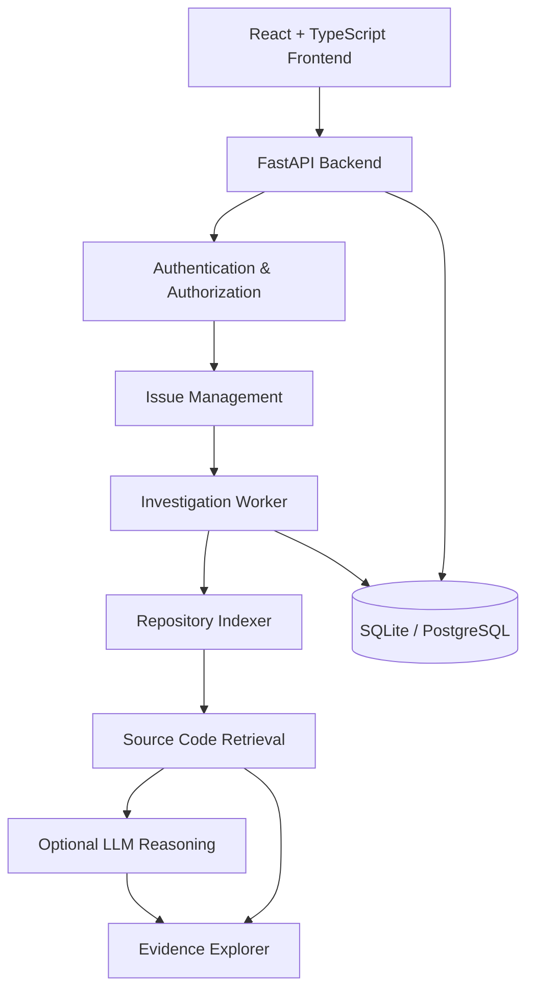

```html
<div align="center">

# 🐞 BugHound-AI

### Autonomous Agentic AI for Software Issue Diagnosis

**An AI-powered platform for intelligent bug investigation, source-code analysis, and evidence-based software debugging.**

<br/>


<br/>


<br/>

**Intelligent Investigation • Source Evidence • AI-Assisted Diagnosis • Secure Workflows**

<br/>

[Overview](#-overview) •
[Features](#-key-features) •
[Architecture](#-system-architecture) •
[Installation](#-installation) •
[Tech Stack](#-technology-stack) •
[Roadmap](#-roadmap)

</div>

---

## 🔍 Overview

**BugHound-AI** is a full-stack, AI-assisted software issue investigation platform designed to help engineering teams analyze bugs, retrieve relevant source code, and investigate potential root causes.

It combines structured issue reporting, immutable Git repository indexing, intelligent code retrieval, background processing, and traceable evidence exploration.

The current local demo supports lexical source retrieval, while live language-model reasoning and semantic search can be enabled through external integrations.

## ✨ Key Features

| Feature | Description |
|:---|:---|
| 🐛 Issue Reporting | Customers submit structured software bug reports |
| 🧠 AI-Assisted Investigation | Generate structured investigation hypotheses with a configured LLM |
| 🔎 Intelligent Code Retrieval | Locate relevant Python source code |
| 📂 Git Repository Indexing | Analyze source files at an immutable Git commit |
| 🔗 Evidence Explorer | Inspect exact lines, symbols, paths and SHA-256 hashes |
| ⚙️ Background Workers | Process investigations asynchronously with durable jobs |
| 🔐 Role-Based Access | Separate customer, engineer and administrator workspaces |
| 📊 Activity Tracking | Review investigation jobs and audit events |
| 🗄️ Database Support | SQLite for local development and PostgreSQL/pgvector stack |

## 🏗️ System Architecture



## 🛠️ Technology Stack

| Category | Technologies |
|---|---|
| Frontend | React, TypeScript, Vite |
| Backend | Python, FastAPI |
| AI Integration | Compatible LLM and Embeddings APIs |
| Source Analysis | Python AST, Git |
| Database | SQLite, PostgreSQL, pgvector |
| Authentication | OIDC, OAuth 2.0 PKCE |
| Deployment | Docker Compose |
| CI/CD | GitHub Actions |
| Testing | Pytest, Frontend Test Suite |

## 🚀 Installation

### Requirements

- Python 3.13
- Node.js 22+
- Git
- PowerShell

### Quick Start

Clone your repository and open its root directory.

```powershell
git clone YOUR_REPOSITORY_URL
cd BugHound-AI
```

Install dependencies and prepare the demo:

```powershell
./scripts/setup.ps1
```

Start the application:

```powershell
./scripts/start.ps1
```

**Application:** http://127.0.0.1:8000

**API Documentation:** http://127.0.0.1:8000/docs

> The local demo uses development authentication and retrieval-only investigation by default. Do not expose demo authentication publicly.

## 🧪 Testing

Run backend tests:

```powershell
.venv/Scripts/python -m pytest -q -p no:cacheprovider
```

Run frontend tests and build:

```powershell
cd apps/web
npm test
npm run build
npm audit
```

## 🗺️ Roadmap

- [x] Customer issue reporting
- [x] Engineer investigation workspace
- [x] Python Git repository indexing
- [x] Evidence-based source retrieval
- [x] Background investigation jobs
- [x] Activity and audit tracking
- [ ] Verify live LLM integration
- [ ] Verify semantic embedding retrieval
- [ ] Complete OIDC provider acceptance
- [ ] Verify PostgreSQL deployment
- [ ] Introduce multi-agent orchestration
- [ ] Add automated debugging and test generation
- [ ] Add human-reviewed patch suggestions

## 📌 Development Status

**Current stage:** Phase 1/2 development implementation.

The integrated local demo is available. Live AI credentials, identity-provider acceptance and PostgreSQL deployment verification are still required before milestone sign-off.

See `docs/DELIVERY.md` for detailed acceptance requirements and known limitations.

---

<div align="center">

### 🐞 BugHound-AI

**Investigate Smarter. Debug Faster. Build Better.**

Built with Python, FastAPI, React, TypeScript and AI technologies.

</div>
```
